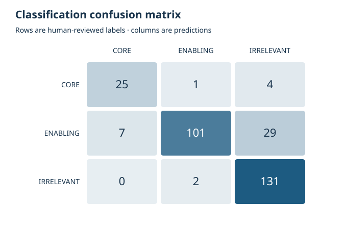

# Evaluation against the 300-family human-reviewed benchmark

Initially AI-assisted; human review confirmed by Team 12. Review independence and procedure are unverified.

The supplied labels exactly match the historical Astra AI artifact. Both comparisons therefore have the same numbers and represent a single benchmark, with updated human-review provenance.

## Overall and cohort results

| Evaluation | Families | Accuracy | Macro F1 | Weighted F1 | Cohen’s κ |
|---|---:|---:|---:|---:|---:|
| Three-class | 300 | 0.8567 | 0.8423 | 0.8545 | 0.7565 |
| Binary relevance | 300 | 0.8833 | 0.8833 | 0.8835 | 0.7691 |
| CLAUDE_CODE_WEB | 88 | 0.8636 | 0.8845 | 0.8617 | 0.7813 |
| CODEX_COMPLETION | 38 | 0.9211 | 0.9397 | 0.9194 | 0.8566 |
| CODEX_LOCAL | 55 | 0.8727 | 0.8325 | 0.8702 | 0.7878 |
| CODEX_WEB_SUBAGENTS | 81 | 0.9506 | 0.8907 | 0.9506 | 0.9096 |
| QWEN_GPU | 38 | 0.5526 | 0.4431 | 0.4985 | 0.2391 |

## Three-class

| Class | Precision | Recall | F1 | Support |
|---|---:|---:|---:|---:|
| CORE | 0.7812 | 0.8333 | 0.8065 | 30 |
| ENABLING | 0.9712 | 0.7372 | 0.8382 | 137 |
| IRRELEVANT | 0.7988 | 0.9850 | 0.8822 | 133 |

| Reference ↓ / Prediction → | CORE | ENABLING | IRRELEVANT |
|---|---:|---:|---:|
| CORE | 25 | 1 | 4 |
| ENABLING | 7 | 101 | 29 |
| IRRELEVANT | 0 | 2 | 131 |

## Binary relevance

| Class | Precision | Recall | F1 | Support |
|---|---:|---:|---:|---:|
| RELEVANT | 0.9853 | 0.8024 | 0.8845 | 167 |
| IRRELEVANT | 0.7988 | 0.9850 | 0.8822 | 133 |

| Reference ↓ / Prediction → | RELEVANT | IRRELEVANT |
|---|---:|---:|
| RELEVANT | 134 | 33 |
| IRRELEVANT | 2 | 131 |

## Limitations

The candidate frame was prefiltered. The benchmark selection probabilities, annotator identities, review procedure and adjudication history are unavailable. ASTRA V4 examples include benchmark families and the reference informed the methodology, so some evaluation leakage is possible.
Cohorts were assigned different families and Qwen used Q9.3. Compare their results descriptively with the class support recorded in the JSON file. A zero-denominator class score is reported as zero.
Retrieval recall requires judgments outside the candidate set or an independent relevant-patent universe.
